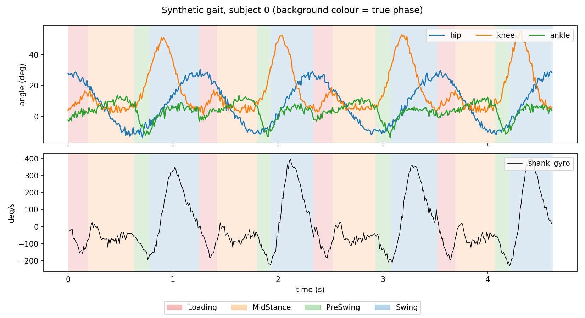
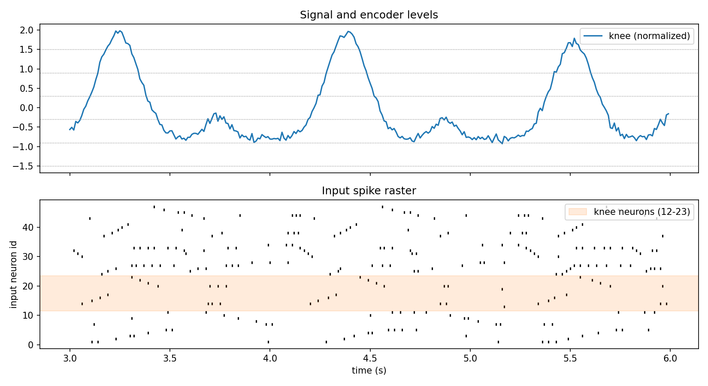
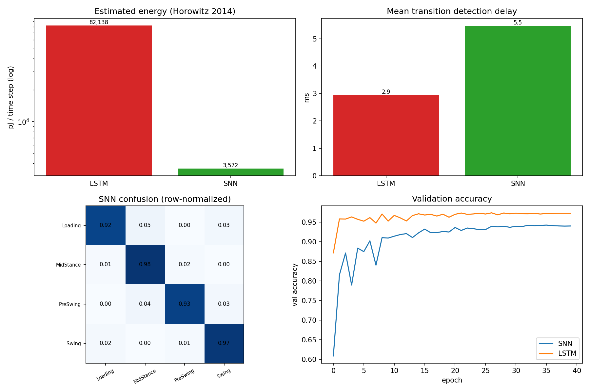
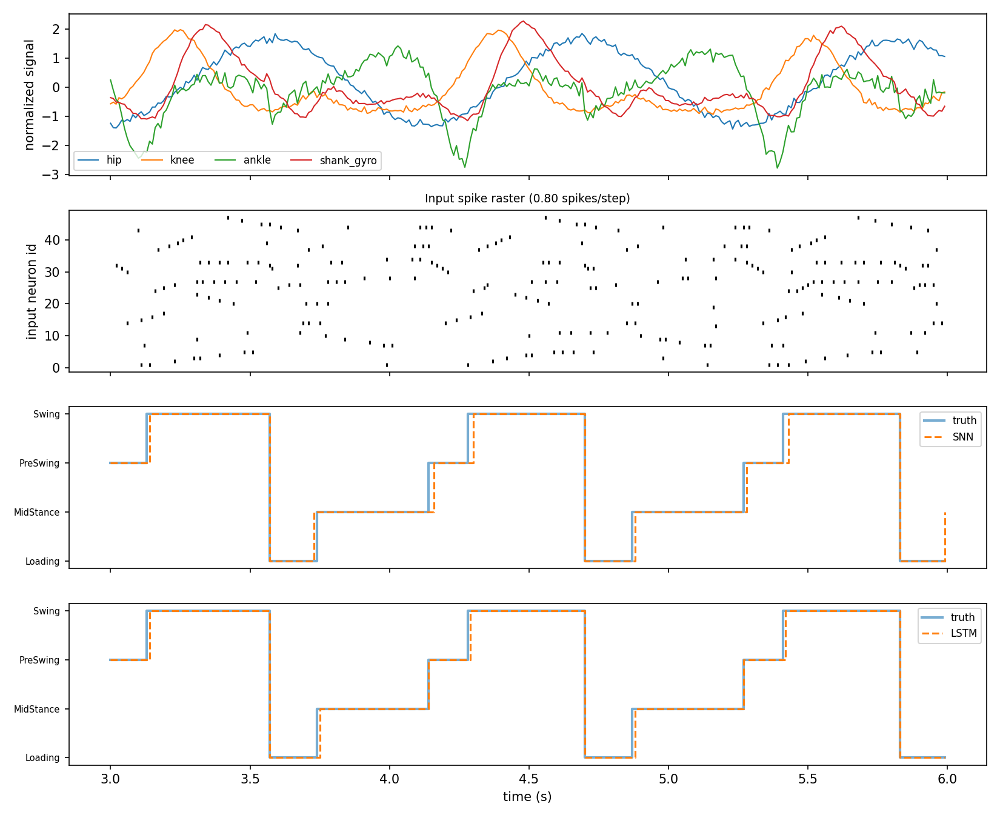

# Event-Driven Spiking Neural Network for Streaming Gait Phase Detection

**Energy–accuracy trade-offs against an LSTM baseline (synthetic-data study)**

**Author:** A S M SAYEM,
---

## Motivation

Real-time gait phase estimation is a building block of lower-limb exoskeleton controllers, which run on battery-powered embedded hardware. This project studies whether an event-driven spiking neural network (SNN) can perform streaming four-phase gait detection (Loading, Mid-Stance, Pre-Swing, Swing) at a much lower *estimated* compute energy than an LSTM. Wearable-style signals (hip, knee and ankle angle, shank angular velocity; 100 Hz) are converted into spikes by a multi-level level-crossing encoder (48 input neurons, 0.92 spikes per time step on average) and processed by a 48-64-64-4 recurrent leaky integrate-and-fire (LIF) network trained with surrogate-gradient backpropagation through time. On four held-out synthetic subjects, the SNN reaches 95.85 ± 0.06 % accuracy (macro-F1 0.948) versus 98.14 ± 0.12 % (0.976) for an LSTM that uses the raw signals, and detects phase transitions with a mean delay of 6.2 ± 1.6 ms versus 3.0 ± 0.2 ms (sampling period 10 ms). Under a first-order analytical energy model based on Horowitz (ISSCC 2014), the SNN needs about 3.5 nJ per time step versus 82 nJ for the LSTM, i.e. **23.5 ± 1.6× lower**, and up to 41× lower with an L1 firing-rate penalty at a cost of roughly 0.4 accuracy points (single seed). The SNN is therefore *less accurate and slightly slower* than the LSTM in this study; its potential advantage is energy, and only on event-driven hardware. All data are synthetic and the energy figures are analytical estimates, so the results are a proof of concept, not evidence of performance on real gait or on real hardware.

## Results at a glance

Test set: 4 unseen synthetic subjects, 28,464 samples (285 s), 956 phase transitions. Mean ± sample standard deviation over 3 training seeds (0, 1, 2).

| Metric | SNN | LSTM |
|---|---|---|
| Accuracy | 95.85 ± 0.06 % | **98.14 ± 0.12 %** |
| Macro-F1 | 0.948 ± 0.001 | **0.976 ± 0.001** |
| Mean transition detection delay | 6.2 ± 1.6 ms | **3.0 ± 0.2 ms** |
| 95th-percentile delay | 23 ± 6 ms (20, 30, 20) | **10 ms** (all seeds) |
| Missed transitions | 0 % | 0 % |
| Parameters | **11,781** | 18,180 |
| Estimated energy per time step | **3.51 ± 0.24 nJ** | 82.1 nJ |
| Estimated energy ratio (LSTM / SNN) | **23.5 ± 1.6×** | – |
| Mean hidden firing rate (L1 / L2) | 0.37 / 0.39 spikes/neuron/step | – |
| CPU time per step (informational) | ~297 µs | ~226 µs |

Per seed:

| Seed | SNN acc | LSTM acc | SNN delay (ms) | LSTM delay (ms) | Energy ratio |
|---|---|---|---|---|---|
| 0 | 95.91 % | 98.05 % | 5.47 | 2.94 | 22.99× |
| 1 | 95.83 % | 98.27 % | 8.04 | 2.88 | 22.14× |
| 2 | 95.80 % | 98.09 % | 5.05 | 3.20 | 25.30× |

The LSTM is ahead in accuracy by 2.1–2.4 points in every seed. **Important:** the three seeds change only weight initialisation and batch order; the data and the subject split are fixed. The ± values therefore do *not* capture variability across subjects.

---

## 1. Motivation and scope

Rehabilitation exoskeletons must know the wearer's gait phase continuously and with minimal delay to time their assistance. Controllers run on embedded, battery-powered processors, so compute energy matters. SNNs communicate with sparse binary events, and a synaptic operation is only needed when a spike arrives. On suitable event-driven hardware this replaces multiply-accumulate (MAC) operations with cheaper accumulates (AC).

This repository is a **self-contained, reproducible feasibility study** on synthetic data. It is not a validated clinical or control system. It asks one question: *how much accuracy and detection delay does an SNN cost, and how much estimated energy does it save, relative to an LSTM, on a streaming gait-phase task?*

## 2. Contributions

- A complete, dependency-light pipeline (NumPy + PyTorch only; the LIF neuron and surrogate gradient are implemented from scratch).
- A subject-wise evaluation protocol with **continuous streaming inference** (state is never reset within a recording) and a transition-level **detection-delay** metric.
- An energy analysis that separates the effect of *sparsity* from the effect of the *AC-versus-MAC cost assumption*, which is often conflated.
- Ablations on firing-rate regularisation, encoder resolution and network size, plus multi-seed statistics.
- An honest account of limitations (Section 7).

## 3. Method

### 3.1 Synthetic gait data

Joint-angle templates for hip, knee and ankle are defined over the normalised gait cycle `p ∈ [0, 1)` (sums of Gaussians and a cosine). The shank angular velocity is the numerical derivative of (hip − knee). Each *subject* has its own stride duration (0.98–1.30 s), range-of-motion gains (0.85–1.15 per joint), sensor offsets (σ = 2°), angle noise (0.7–1.8°) and gyroscope noise (8–20 °/s); each stride additionally varies by ±8 % in duration and ±5 % in amplitude. Each subject contributes 60 strides at 100 Hz.

Phase labels are fixed fractions of the gait cycle: Loading 0–15 %, Mid-Stance 15–50 %, Pre-Swing 50–62 %, Swing 62–100 %.

| Split | Subjects (RNG seeds) | Samples | Duration | Phase transitions |
|---|---|---|---|---|
| Train | 8 (0–7) | 55,107 | 551 s | 1,912 |
| Validation | 2 (100–101) | 15,169 | 152 s | 478 |
| Test | 4 (200–203) | 28,464 | 285 s | 956 |

Class balance (all splits): Loading 15.4 %, Mid-Stance 34.8 %, Pre-Swing 12.2 %, Swing 37.6 %. Mean phase dwell time on the test set: Loading 183 ms, Mid-Stance 413 ms, Pre-Swing 145 ms, Swing 446 ms. Splits are by subject, and normalisation statistics are fitted on training subjects only.


*Figure 1. Synthetic gait for subject 0 (4 strides). Background colour shows the true phase.*

### 3.2 Event encoding (multi-level level crossing)

Each normalised channel is compared with `L = 6` fixed levels in `[-1.5, 1.5]` (−1.5, −0.9, −0.3, 0.3, 0.9, 1.5). An UP neuron spikes when the signal crosses a level upward, a DOWN neuron when it crosses downward, so `4 channels × 6 levels × 2 directions = 48` input neurons (index = `channel·2L + direction·L + level`). A constant signal produces no spikes. On the test set the encoder emits 0.92 spikes per step on average (max 4); 65.4 % of time steps contain at least one spike. Average spikes per step by channel: ankle 0.39, shank gyro 0.22, hip 0.19, knee 0.11.


*Figure 2. Knee signal with encoder levels (top) and the resulting input spike raster (bottom; knee neurons 12–23 highlighted).*

### 3.3 Spiking network

Architecture: `48 → 64 (recurrent LIF) → 64 (LIF) → 4 (non-spiking leaky readout)`, 11,781 parameters. For hidden layer `ℓ` and neuron `i`:

```
ũ_i[t] = β_i · u_i[t-1] + I_i[t]
s_i[t] = H(ũ_i[t] − θ)               θ = 1
u_i[t] = ũ_i[t] − θ · s_i[t]         (reset by subtraction)
I¹[t] = W₁ x[t] + b₁ + W_rec s¹[t-1]     I²[t] = W₂ s¹[t] + b₂
o[t]  = β_o · o[t-1] + W₃ s²[t] + b₃     ŷ[t] = argmax o[t]
```

`β_i = sigmoid(b_logit_i)` is learnable per neuron (initialised on a grid in 0.8–0.99). After training, the mean β is 0.896 (layer 1) and 0.895 (layer 2), range 0.76–0.99, corresponding to membrane time constants of roughly 9 steps (~90 ms) on average. The spike function `H` is a Heaviside step in the forward pass; in the backward pass a fast-sigmoid surrogate gradient `1/(1 + α|x|)²` with α = 10 is used (cf. SuperSpike; Neftci et al., 2019). The reset term is detached from the gradient.

### 3.4 LSTM baseline

`4 → LSTM(64) → Linear(4)` on the raw normalised signals, 18,180 parameters, run in the same streaming fashion.

### 3.5 Training

Chunks of 100 steps (1 s, stride 50) are cut from each training subject (1,090 training chunks, 300 validation chunks). Loss: cross-entropy at every time step after a 10-step warm-up, so the network predicts continuously; optionally plus `λ·(r₁ + r₂)` where `r` is the mean firing rate of a hidden layer. Adam, cosine learning-rate decay, batch 64, 40 epochs, gradient-norm clipping at 5; learning rate 2·10⁻³ (SNN) and 5·10⁻³ (LSTM). The epoch with the best validation accuracy is kept. **No hyper-parameter search was performed for either model.**

### 3.6 Energy model

First-order model after Horowitz (ISSCC 2014; 45 nm, 32-bit float): multiply 3.7 pJ, add 0.9 pJ, hence `E_MAC = 4.6 pJ`, `E_AC = 0.9 pJ`.

```
LSTM:  N_MAC = 4(n_in·n_h + n_h²) + n_h·n_out + 3·n_h = 17,856        E = N_MAC · E_MAC
SNN :  N_AC  = s_in·n_h + s₁·n_h (recurrent) + s₁·n_h + s₂·n_out       (s = measured spikes per step)
       N_MAC = 2·n_h + n_out = 132  (membrane-decay updates)            E = N_AC·E_AC + N_MAC·E_MAC
```

Spike rates are measured on the test streams. **Not counted:** memory access, activation functions (sigmoid/tanh in the LSTM), biases, the encoder, and neuron-state reads/writes. This is a first-order estimate, not a hardware measurement.

## 4. Evaluation protocol

- **Streaming:** each test subject is processed as one continuous stream with persistent state, as an on-line controller would.
- **Metrics:** accuracy and macro-F1 over all test samples after discarding the first 50 samples of each stream; per-class F1; confusion matrix.
- **Detection delay:** for each true transition into phase `c`, the number of samples until the model first predicts `c` (searched up to 300 ms). Resolution is 10 ms. A prediction that is already correct at the transition (including an *early* switch) counts as 0 delay. Transitions never detected within the window count as *missed*.
- **CPU time per step** is measured with single-thread PyTorch on one Colab CPU. It is informational only because PyTorch evaluates spikes as dense tensors.

## 5. Results

### 5.1 Overall performance

See the table at the top. Both models detect all 956 test transitions (0 missed). Neither model needs smoothing: the SNN switches phase 960 times against 952 true switches (ratio 1.01), the LSTM 952 times (1.00), so neither flickers.


*Figure 3. Main run (seed 0): estimated energy per step (log scale), mean detection delay, row-normalised SNN confusion matrix, validation accuracy per epoch.*


*Figure 4. Test subject 200, samples 300–600 (3 s), main run: normalised signals, input spike raster, and SNN/LSTM predictions against the true phase. Accuracy in this window: SNN 96.3 %, LSTM 98.3 %.*

### 5.2 Per-class results (main run, seed 0)

| Phase | SNN F1 | LSTM F1 | SNN recall | LSTM recall |
|---|---|---|---|---|
| Loading | 0.928 | 0.973 | 0.918 | 0.968 |
| Mid-Stance | 0.970 | 0.984 | 0.977 | 0.979 |
| Pre-Swing | 0.922 | 0.954 | 0.932 | 0.959 |
| Swing | 0.974 | 0.989 | 0.968 | 0.994 |

The SNN–LSTM gap is largest for Loading (4.5 points) and Pre-Swing (3.2 points), the two shortest phases.

Confusion matrices (rows = true, columns = predicted; order Loading, Mid-Stance, Pre-Swing, Swing):

```
SNN                              LSTM
[[ 3956   218     0   134]       [[ 4170    50     0    88]
 [   79  9558   149     0]        [   79  9583   124     0]
 [    0   149  3241    88]        [    0    59  3334    85]
 [  180     0   159 10353]]       [   11     0    54 10627]]
```

### 5.3 Where do the errors occur?

For the SNN (main run), 97.8 % of the 1,156 misclassified samples lie within 30 ms of a true phase boundary, 2.1 % are 30–100 ms away and 0.2 % more than 100 ms away. For the LSTM, all 550 errors lie within 30 ms of a boundary. Every confusion in the matrices above is between *adjacent* phases. For the SNN, 635 errors are early switches (the next phase predicted too soon) and 521 are late switches, so the errors look like timing jitter around boundaries rather than a systematic lag.

Detection-delay distribution (main run, 952 transitions, bins of 10 ms):

| Delay | 0 | 10 | 20 | 30 | 40 | 50 |
|---|---|---|---|---|---|---|
| SNN | 627 | 182 | 103 | 30 | 7 | 3 |
| LSTM | 688 | 248 | 16 | 0 | 0 | 0 |

The SNN's tail is heavier (maximum 50 ms versus 20 ms). Because early switches count as zero delay, the delay metric should be read together with accuracy, not on its own.

### 5.4 Energy breakdown

Main run, per time step:

| Component | ACs | Energy | Share of synaptic |
|---|---|---|---|
| Input → L1 (`fc1`) | 59 | 53 pJ | 1.8 % |
| L1 → L1 (recurrent) | 1,571 | 1,414 pJ | 47.7 % |
| L1 → L2 (`fc2`) | 1,571 | 1,414 pJ | 47.7 % |
| L2 → output (`fc3`) | 94 | 84 pJ | 2.8 % |
| **Synaptic total** | 3,294 | 2,965 pJ | |
| Membrane-update MACs (132) | | 607 pJ | |
| **SNN total** | | **3,572 pJ** | |
| LSTM (17,856 MACs) | | 82,138 pJ | |

Where the 23× comes from (main run):

- **About 5.2×** is the plain operation-count ratio (LSTM MACs divided by SNN accumulates plus update MACs), i.e. the effect of sparsity and the smaller network.
- The remaining **about 4.4×** comes from the assumption that an accumulate (0.9 pJ) is cheaper than a MAC (4.6 pJ).
- As a reference, a hypothetical SNN in which every neuron spikes at every step would cost 10,975 pJ, still 7.5× below the LSTM under this model. A substantial part of the estimated advantage thus depends on the hardware assumption, not on sparsity alone.
- About 95 % of synaptic operations are in the two 64 × 64 hidden connections. Reducing input spikes (fewer encoder levels) barely changes the energy; reducing the *hidden* firing rate does.

### 5.5 Ablations (single run each, seed 0)

| Setting | SNN acc | SNN macro-F1 | SNN delay (ms) | Input spikes/step | Hidden rate L1 / L2 | SNN energy (pJ) | Ops ratio | Energy ratio |
|---|---|---|---|---|---|---|---|---|
| Baseline | 95.9 % | 0.949 | 5.47 | 0.92 | 0.38 / 0.37 | 3,572 | 5.2× | 23.0× |
| Rate penalty λ = 0.01 | 95.8 % | 0.948 | 5.28 | 0.92 | 0.32 / 0.34 | 3,067 | 6.2× | 26.8× |
| Rate penalty λ = 0.1 | 95.5 % | 0.943 | 6.38 | 0.92 | 0.18 / 0.21 | 2,005 | 10.6× | 41.0× |
| 4 encoder levels | 95.5 % | 0.943 | 5.95 | 0.64 | 0.31 / 0.38 | 3,009 | 6.4× | 27.3× |
| Hidden size 32 | 95.1 % | 0.939 | 9.17 | 0.92 | 0.36 / 0.37 | 1,037 | 5.5× | 21.4× |

For reference, the LSTM in the same runs reaches 98.1 / 98.1 / 98.1 / 97.8 / 97.5 % (the first three rows share one LSTM because the penalty only affects the SNN).

How to read this table: the seed-to-seed standard deviation of the baseline SNN is 0.06 accuracy points, 1.6 ms delay and about 240 pJ energy.

- λ = 0.1 lowers the firing rate by roughly half and the estimated energy by 44 % at ≈ 0.4 points of accuracy. The energy change is far outside seed variation; the accuracy drop is larger than the seed std, but each setting is a single run.
- λ = 0.01 and 4 levels give energy reductions of about 2 seed standard deviations: suggestive, not conclusive.
- No delay difference is distinguishable from seed noise (baseline seeds span 5.1–8.0 ms), except possibly the smaller network (9.2 ms; the LSTM-32 also slows down: 4.0 ms).
- Halving the hidden size reduces absolute SNN energy by 71 % at ~0.8 points lower accuracy, but the *ratio* to an equally shrunk LSTM stays about the same.

### 5.6 CPU time

On one Colab CPU thread (Intel Xeon @ 2.0 GHz) the SNN takes about 297 µs per step and the LSTM about 226 µs (mean of 3 seeds). The SNN is slower because PyTorch evaluates it densely; both are far below the 10 ms sampling period. This number says nothing about event-driven hardware.

## 6. Discussion

In this study the LSTM wins on accuracy (+2.3 points, consistent across seeds) and on detection delay, and the SNN wins on estimated energy (≈ 23×, ≈ 41× with a firing-rate penalty) and parameter count. We do **not** find that the SNN detects transitions faster. The SNN's errors are almost entirely boundary jitter of at most a few samples, and the shortest phases (Loading, Pre-Swing) suffer most, plausibly because the same timing error is a larger fraction of a shorter phase (not tested directly). Level-crossing quantisation into six levels is one candidate cause of the accuracy gap; reducing to four levels cost about 0.4 points, but eight levels were not tested.

The energy advantage should be interpreted carefully. It stems both from sparsity (≈ 5×) and from the assumption that spike-driven accumulates are 5× cheaper than MACs (≈ 4×). The model ignores memory traffic, which dominates energy in many real implementations, and ignores LSTM activation functions, which would raise the LSTM's cost. A fair hardware comparison would also include a quantised (e.g. INT8) LSTM. Whether the SNN saves energy in practice therefore depends on the target platform.

## 7. Limitations

1. **Synthetic data.** Signals are template-plus-noise with labels defined by gait-cycle fraction, not by measured gait events (heel strike, toe-off). There are no sensor artefacts, no non-level walking, no pathological gait, and all subjects share the same template (they differ only in scale, offset, noise and stride time). Accuracy near 96–98 % says little about real data.
2. **Small cohort, fixed split.** 8/2/4 subjects. The three seeds share the same data, so reported ± values reflect training randomness only. Leave-one-subject-out or repeated random subject splits would be needed for between-subject variability.
3. **Analytical energy only.** No hardware measurement; FP32 operands; 45 nm figures; memory access, activation functions, encoder cost and state updates are not counted; a zero cost for skipping inactive neurons is assumed.
4. **Limited baselines.** One LSTM with its own input representation (raw signals versus 48 spike channels), untuned. No GRU, TCN, 1D-CNN, quantised model or classical threshold/rule-based detector.
5. **No hyper-parameter tuning** for either model; the gap may change with tuning.
6. **Delay metric.** 10 ms resolution; early predictions count as 0 delay; delay is measured against labels defined by a cycle clock.
7. **CPU timing** is not representative of embedded or neuromorphic hardware.

## 8. Reproducibility

- **Environment of the reported runs (Google Colab, CPU):** Python 3.13.16, PyTorch 2.11.0+cu130, NumPy 2.1.3, pandas 2.2.3; Intel Xeon @ 2.00 GHz, 2 cores, `torch.set_num_threads(1)`. The models were run on the CPU (CUDA was available but unused). Total time for one 40-epoch run (SNN + LSTM): about [X] minutes.
- **Seeds:** Python, NumPy and PyTorch seeds are set from `Cfg.seed`. Data generation uses fixed subject seeds (0–7, 100–101, 200–203).
- **Check performed:** re-evaluating the stored main-run checkpoints reproduces the stored test metrics exactly (SNN 0.9591, LSTM 0.9805). Bit-wise reproducibility of re-training on other machines or library versions was not verified.
- `requirements.txt` is not version-pinned; pin the versions above for exact reproduction.

**Colab (used for the reported results).** Open the notebook, mount Google Drive and run the cells in order. The notebook writes the `src/` modules to Drive, runs the main experiment, the ablations and the seeds, and caches each finished run in `results/<name>/`. Set `PROJECT` to your Drive folder (default `/content/drive/MyDrive/snn-gait-phase`).

**Command line (provided; the reported results were produced via the notebook).**

```bash
git clone https://github.com/USER/REPO.git && cd REPO
pip install -r requirements.txt
cd src
python run_experiment.py --epochs 40 --out ../results/main
python run_experiment.py --seed 1 --out ../results/seed1
python run_experiment.py --seed 2 --out ../results/seed2
python run_experiment.py --rate_reg 0.01 --out ../results/rate_reg_0.01
python run_experiment.py --rate_reg 0.1  --out ../results/rate_reg_0.1
python run_experiment.py --n_levels 4    --out ../results/levels_4
python run_experiment.py --hidden 32     --out ../results/hidden_32
```

Aggregation (ablation table, multi-seed statistics, final report) is done in the notebook.

## 9. Repository structure

```
├── README.md
├── requirements.txt
├── src/
│   ├── settings.py        # Cfg and constants
│   ├── gait_data.py       # synthetic gait generator
│   ├── encoding.py        # level-crossing encoder, dataset builder
│   ├── models.py          # LIF SNN (surrogate gradient) and LSTM
│   ├── energy.py          # Horowitz-based energy model
│   ├── train_eval.py      # training, streaming evaluation, metrics
│   ├── experiment.py      # run(), plots, saving
│   └── run_experiment.py  # command-line entry point
├── notebooks/             # Colab notebook
├── results/               # per run: results.json, snn.pt, lstm.pt, figures; ablation.csv; multiseed.json; final_report.txt
└── figures/               # data and encoding illustrations
```

## 10. Future work

- Real data, e.g. open lower-limb datasets (Camargo et al., 2021; check licence and format) with event-based labels from foot switches or force plates.
- Subject-wise cross-validation and more seeds; additional baselines (GRU, TCN, 1D-CNN, INT8 LSTM, rule-based detector).
- More encoder levels, delta/threshold encoders, learned thresholds; hyper-parameter tuning for both models.
- Evaluation on event-driven hardware or a hardware-aware simulator, with memory-access costs.
- Integer/quantised SNN weights.

## 11. References

1. M. Horowitz, "Computing's energy problem (and what we can do about it)," in *IEEE ISSCC Dig. Tech. Papers*, 2014, pp. 10–14.
2. E. O. Neftci, H. Mostafa, F. Zenke, "Surrogate gradient learning in spiking neural networks," *IEEE Signal Processing Magazine*, 36(6):51–63, 2019.
3. F. Zenke, S. Ganguli, "SuperSpike: Supervised learning in multilayer spiking neural networks," *Neural Computation*, 30(6):1514–1541, 2018.
4. S. Hochreiter, J. Schmidhuber, "Long short-term memory," *Neural Computation*, 9(8):1735–1780, 1997.
5. D. P. Kingma, J. Ba, "Adam: A method for stochastic optimization," *ICLR*, 2015.
6. M. Miśkowicz, "Send-on-delta concept: an event-based data reporting strategy," *Sensors*, 6(1):49–63, 2006.
7. J. Taborri et al., "Gait partitioning methods: a systematic review," *Sensors*, 16(1):66, 2016.
8. J. Camargo et al., "A comprehensive, open-source dataset of lower limb biomechanics in multiple conditions of stairs, ramps, and level-ground ambulation and transitions," *J. Biomechanics*, 119:110320, 2021.
9. M. Davies et al., "Loihi: A neuromorphic manycore processor with on-chip learning," *IEEE Micro*, 38(1):82–99, 2018.
10. A. Paszke et al., "PyTorch: An imperative style, high-performance deep learning library," *NeurIPS*, 2019.
11. G. Dampfhoffer et al., "Are SNNs really more energy-efficient than ANNs? An in-depth hardware-aware study," *IEEE Trans. Emerging Topics in Computational Intelligence*, 2023.

